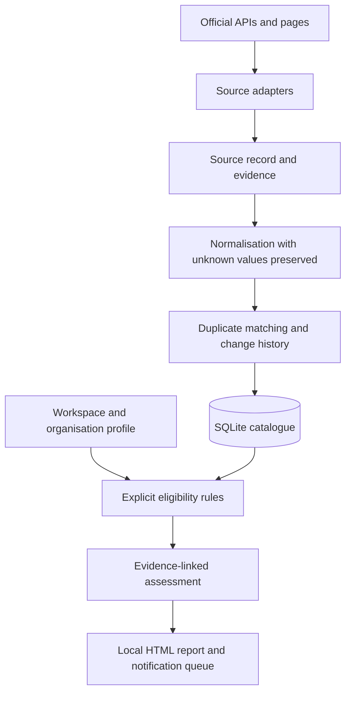

# CallBrief

A local prototype for funding-opportunity research, source provenance and evidence-linked eligibility checks.

**Status:** The approved product direction is desktop-first. The public `main` branch is still a local Python command-line prototype. It is not a commercial application or hosted service.

The prototype keeps source facts, user-provided organisation profiles and eligibility rules separate. Missing or unsupported evidence produces an uncertain result; a score is not a prediction that an application will succeed.

## Problem and approach

Funding and procurement opportunities are published across separate portals and formats. Advisers need to compare a call with a specific organisation while seeing which facts came from a source, which were inferred and what remains unknown.

CallBrief reads selected public sources, normalises fields into a common model, keeps source-specific evidence, and evaluates explicit rules against a workspace and organisation profile. It stores the catalogue and local assessments in SQLite and can produce an evidence-linked HTML report.

## Current source coverage

### [Funding & Tenders](https://ec.europa.eu/info/funding-tenders/opportunities/portal/screen/support/apis)

- **Adapter:** Public search API. **Records:** EU programme calls.
- **Reuse:** Conditions for reusing the API data need specific confirmation.

### [TED](https://docs.ted.europa.eu/api/latest/search.html)

- **Adapter:** Search API. **Records:** Public procurement notices, not grants.
- **Reuse:** See the [TED legal notice](https://ted.europa.eu/en/legal-notice); its conditions apply.

### [CINEA LIFE calls](https://cinea.ec.europa.eu/life-calls-proposals-2026_en)

- **Adapter:** Agency call pages. **Records:** LIFE call identifiers, status, dates and links.
- **Reuse:** Commission reuse generally requires attribution and may have exceptions or third-party rights. This is not clearance for every field.

### [Portugal 2030 annual plan](https://portugal2030.pt/plano-anual-de-avisos/)

- **Adapter:** XLSX. **Records:** Forecasts of future calls, not confirmation that a call is open.
- **Reuse:** The file's terms need confirmation; commercial redistribution is disabled.

### COMPETE 2030 open notices

- **Adapter:** None active. Some notices appear in the manual evaluation sample.
- **Reuse:** Portal terms restrict copying and redistribution. An authorised structured source or clarification is still needed.

This is an engineering source review, not legal clearance. The app labels the annual-plan data as forecasts. It does not treat a predicted date as an open call. Agent-Reach has a tested adapter contract with a fake service; a real local bridge has not been run and is not part of CI.

## Data flow



Adapters keep provider formats out of the domain rules. The shared catalogue preserves source variants so that normalisation or deduplication does not erase provenance. Workspace and organisation identifiers scope profiles, assessments and local notifications.

## Eligibility and evidence

Each rule reports one of four states:

- **Eligible:** the known, evidence-backed requirements are met.
- **Ineligible:** at least one deterministic mandatory rule failed.
- **Remediable:** the evidence identifies a requirement that may be addressed.
- **Uncertain:** profile data, source evidence or a normalised rule is missing.

Every rule points to evidence and, where relevant, a corrective action. Without supporting evidence, a rule cannot confirm eligibility. Strategic-fit scores use configurable signals; components without a score are excluded from the average. The report does not estimate a probability of funding success.

The report escapes untrusted HTML, accepts HTTPS links only and runs no JavaScript. Evidence records identify whether a fact came from a live source, a captured fixture or manual transcription, alongside the source URL and excerpt.

## Evaluation evidence

The repository contains a manually transcribed sample and a labelled retrieval evaluation. These results describe a small development artefact, not the quality of a production service.

### Manual source-check workflow, 08/10/2026

Four of four adapters returned accepted records and produced 67 records. The action published a compact summary, not source response bodies. This is one dated run, not a guarantee of current availability. [Run details](https://github.com/WhiteBlindness/callbrief/actions/runs/37701724994)

### Manually transcribed evaluation corpus

The sample contains 30 records from COMPETE, Funding & Tenders and CINEA. Records retain links and excerpts but have no original-response hashes; the live adapters did not collect them.

### Retrieval labels

The evaluation has 59 queries: 19 for calibration and 40 for validation, including 12 with no relevant answer. Labels were prepared in one pass and were not independently reviewed.

### Retrieval on answerable validation queries

Across 34 answerable queries, Recall@5 is 0.912 and MRR@5 is 0.877 for both the reference and current method. No ranking improvement was measured on this set.

### Abstention on no-answer validation queries

Across six no-answer queries, precision is 0.556 and recall is 0.833. The system also refused 11.8% of answerable queries.

### Normalisation and structured citations

All 185 checked fields and excerpts passed on the same manually prepared corpus. These checks are not an independent annotation.

The live collection and the labelled corpus are separate. The manual workflow reported 20 Funding & Tenders records, 20 TED records, 20 annual-plan rows and seven CINEA records, with 489 evidence items. It did not publish the response bodies. The evaluation does not demonstrate source coverage over time, ranking quality in real use, eligibility accuracy across funding programmes or likely funding outcomes.

The project also documents a controlled duplicate-matching check with five labelled CINEA/Funding & Tenders pairs and ten negative corpus pairs. A separate live comparison found no matches among 140 pairs from the first pages of those two sources. That result is a bounded sample, not a measure of general duplicate-detection performance.

## Run locally

Requirements: Python 3.12 or newer. The core package has no runtime dependencies.

```powershell
python -m venv .venv
.venv\Scripts\Activate.ps1
python -m pip install -e .
callbrief source list
callbrief source check eu_funding_tenders --query "SME research" --limit 10
callbrief source check portugal2030_annual_plan --limit 10
callbrief discover --source eu_funding_tenders --query "SME research" --database callbrief.sqlite3
callbrief opportunity list --database callbrief.sqlite3
```

Create a local organisation profile and produce an assessment:

```powershell
callbrief organisation add `
  --database callbrief.sqlite3 `
  --workspace-id consultancy `
  --workspace-name "Example consultancy" `
  --id client-a `
  --name "Client A" `
  --country PT `
  --company-size PME

callbrief assess-opportunity `
  --database callbrief.sqlite3 `
  --workspace-id consultancy `
  --organisation-id client-a `
  --opportunity-id <CALL_ID> `
  --output assessment.html
```

The `--region` and `--geography` filters compare organisation data with the normalised call fields. Unknown profile values stay empty. The result depends on the source facts and rules available for that call.

Run the local checks and reproducible retrieval reports with:

```powershell
python -m unittest discover -s tests -v
python -m compileall -q src tests evals
python evals/retrieval_benchmark.py
python -m evals.real_corpus_benchmark
```

## Development timeline

- **27/09/2026:** evidence-linked funding-call review introduced in [commit `cd63327`](https://github.com/WhiteBlindness/callbrief/commit/cd63327).
- **07/10/2026:** funding-source intelligence and evidence-backed assessments added in [PR #1](https://github.com/WhiteBlindness/callbrief/pull/1).
- **07/10/2026:** reproducible manual checks for live adapters added through [PR #3](https://github.com/WhiteBlindness/callbrief/pull/3) and [PR #4](https://github.com/WhiteBlindness/callbrief/pull/4).
- **08/10/2026:** the v0.2 official-source adapters and evaluation pipeline integrated in [commit `b0f1c2c`](https://github.com/WhiteBlindness/callbrief/commit/b0f1c2ca3bc0df8c0121c14bb581faf7a72336f2).

These dates describe commits and integration. They are not launch or commercial-acceptance dates.

## Data handling and known limitations

- SQLite stores shared opportunity facts once, source variants separately, and profiles and assessments by workspace and organisation.
- The funding-opportunity flow does not send documents to a language model. A separate `callbrief assess` command supports local document review with a Chat Completions-compatible model; sending excerpts to a remote service requires an explicit `--allow-remote` option.
- The manual corpus has no hashes of its original source responses. Live source checks create a separate temporary collection and publish only a compact result summary.
- Funding & Tenders data reuse conditions need specific confirmation. Commercial redistribution of the Portugal 2030 annual-plan fields is disabled pending clarification. The active adapters do not collect formally open COMPETE or Portugal 2030 notices.
- Eligibility uses normalised fields and user-provided profiles. It does not interpret notice PDFs or prove an organisation's eligibility from complete source documents.
- The sample and labels are small and were not independently reviewed. Retrieval matched the reference method on the measured validation set; the evaluation does not establish production accuracy.
- Change tracking has controlled fixture coverage, but the sample does not establish that real call changes or alerts are detected. Notifications remain local; no email or message is sent.
- No NIPC enrichment provider is connected. Agent-Reach's real bridge has not been tested.
- No desktop application, hosted service, user accounts or automatic application submission is implemented.

## Current product direction

The next product direction is a desktop-first workflow. The existing local CLI and evidence model are prototype components; a desktop interface, broader authorised source coverage and independently reviewed evaluation remain future work.
